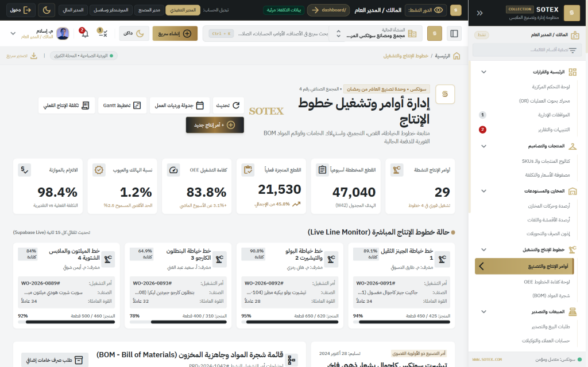
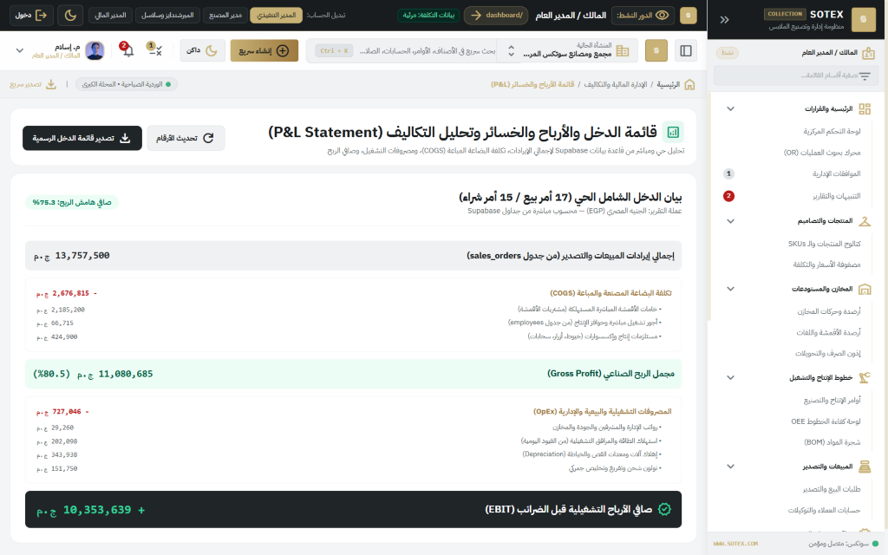

# SOTEX Garment Manufacturing ERP — منظومة سوتكس لإدارة وتصنيع الملابس

[](https://nextjs.org/)
[](https://react.dev/)
[](https://www.typescriptlang.org/)
[](https://supabase.com/)

**SOTEX Garment ERP** is an end-to-end, Arabic-first (RTL) Enterprise Resource Planning platform purpose-built for **garment and textile manufacturing**. It unifies factory floor operations, fabric/batch inventory, BOM & SKU matrices, AQL quality assurance, sales & procurement, double-entry finance & live P&L, piecework HR payroll, **PostgreSQL Row Level Security (RLS)**, and an integrated **Operations Research (OR) Profit Optimization Engine** across **42 relational Supabase tables**.

> 📄 **Full Commercial & Engineering Proposal (بربوزال تجاري وهندسي شامل):** See [docs/PROPOSAL_AR_EN.md](docs/PROPOSAL_AR_EN.md)

---

## Key Capabilities & Why SOTEX Is Different

- **Industry-Specific Garment Workflows:** Built around fabric batches/lots, `BOM` consumption per piece, `Color × Size` SKU matrices, cutting/sewing/finishing stages, `OEE` line efficiency, `AQL` quality inspections, and piecework payroll.
- **Operations Research (OR) Engine (`/optimization`):**
  - **Linear Programming Product Mix:** Recommends optimal production quantities (`x*`) to maximize profit under live fabric & line-hour constraints.
  - **Critical Ratio (CR) & EDD Scheduling:** Prioritizes work orders by due date & line OEE to prevent delivery penalties.
  - **Inventory EOQ & Reorder Point (ROP):** Computes Economic Order Quantities and Safety Stock from live inventory & usage.
- **Database-Enforced RBAC & RLS:** 4 core roles (`OWNER_ADMIN`, `PRODUCTION_MANAGER`, `WAREHOUSE_MANAGER`, `FINANCE_SALES_MANAGER`) enforced both in the UI (`AppShell` route guard + role-filtered `Sidebar`) and inside PostgreSQL via `x-sotex-role` RLS policies (`public.get_current_user_role()`).
- **Tamper-Proof Audit Trail:** `audit_logs` is protected by a PostgreSQL trigger (`trg_audit_logs_immutable`) that rejects any `UPDATE` attempt.

---

## System Screenshots

| Executive Dashboard (`/dashboard`) | Operations Research Engine (`/optimization`) |
|---|---|
|  |  |

| Production & OEE (`/production`) | Inventory & Fabrics (`/inventory`) |
|---|---|
|  |  |

| Finance & Live P&L (`/finance/pnl`) | Quality AQL (`/quality`) |
|---|---|
|  |  |

---

## Architecture & Project Structure

```text
sotex/
├── sotex/
│   ├── app/                  # 63 Next.js App Router pages (dashboard, optimization, production, inventory, finance, sales, procurement, quality, hr, settings)
│   ├── components/           # AppShell (route guard), Sidebar (role-filtered), Header, RolePreviewBar, ActionModal, UI primitives
│   ├── lib/
│   │   ├── erp-context.tsx   # Global ERP state + live Supabase sync + role switching
│   │   ├── or-engine.ts      # Operations Research algorithms (LP Product Mix, EOQ/ROP, CR Scheduling)
│   │   ├── supabase.ts       # Supabase client with x-sotex-role header injection & audit logger
│   │   └── constants.ts      # 4 Core RBAC role definitions & nav prefixes
│   ├── supabase/             # Schema migrations & seed SQL
│   └── tests/
│       ├── frontend-logic.test.ts  # 12 unit tests (RBAC, KPIs, OEE, AQL, OR algorithms)
│       └── backend.test.ts         # 14 integration tests (42 tables, CRUD, RLS, immutable audit trigger)
└── docs/
    ├── PROPOSAL_AR_EN.md     # Full Arabic/English Commercial & Engineering Proposal
    └── screenshots/          # Live system screenshots across all modules
```

---

## Getting Started

1. **Configure Environment:**
   Copy `.env.example` to `sotex/.env.local` and set your Supabase credentials:
   ```env
   NEXT_PUBLIC_SUPABASE_URL=https://your-project.supabase.co
   NEXT_PUBLIC_SUPABASE_ANON_KEY=your-anon-key
   ```

2. **Install & Run:**
   ```bash
   npm --prefix sotex install
   npm run dev
   ```
   Open [http://localhost:3000](http://localhost:3000).

3. **Build & Verify:**
   ```bash
   npm run build
   npm --prefix sotex run test
   ```
   - Frontend logic & OR suite: **12/12 passed**
   - Backend Supabase CRUD & RLS suite: **14/14 passed**
