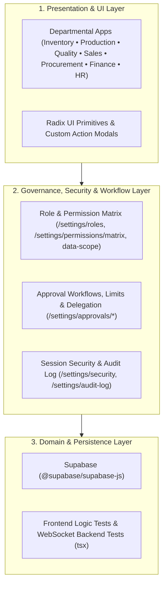

# Sotex ERP (`sotexerp`) — Textile & Garment Manufacturing ERP Platform

A comprehensive, modular Enterprise Resource Planning (ERP) platform tailored for **textile and garment manufacturing**, covering fabric inventory, Bill of Materials (BOM), OEE production tracking, inline quality inspections, procurement, sales, HR/payroll, double-entry finance, and fine-grained RBAC approval workflows.

---

## 1. Executive Summary & Purpose
`sotexerp` replaces disconnected spreadsheets across factory departments with a single source of truth (`sotex/`). Built with Next.js, Radix UI, and Supabase, it models real-world textile manufacturing workflows—from fabric roll tracking and multi-stage production planning to defect inspection, customer quotations, payroll, and general ledger accounting.

---

## 2. System Architecture & Layers



| Layer | Responsibility | Key Modules |
| :--- | :--- | :--- |
| **Core ERP UI Layer** | Departmental operational workspaces, KPIs (`/dashboard`, `/reports`, `/tasks`), and modals | `sotex/app/{dashboard,reports,tasks}/page.tsx`, `sotex/components/ui/*` |
| **Manufacturing & Quality Layer** | Fabric inventory, BOM, production stages, OEE metrics, and quality defect tracking | `sotex/app/inventory/*`, `sotex/app/production/*`, `sotex/app/quality/*`, `sotex/app/products/*` |
| **Commercial & Back-Office Layer** | Procurement, sales quotations, general ledger/P&L/treasury, and HR/payroll | `sotex/app/procurement/*`, `sotex/app/sales/*`, `sotex/app/finance/*`, `sotex/app/hr/*` |
| **Enterprise Governance Layer** | Role comparisons, data-scoping, multi-step approval limits/delegation, and audit trails | `sotex/app/settings/{roles,permissions,approvals,security,users,audit-log}/*` |
| **Backend & Verification Layer** | Supabase persistence and dual `tsx` test suites (frontend logic + backend WebSocket tests) | `sotex/tests/frontend-logic.test.ts`, `sotex/tests/backend.test.ts` |

---

## 3. Core Functionality & Modules
- **Inventory & Fabric Management (`/inventory`)**: Track fabric lots (`/inventory/fabrics/[id]`), stock counts (`/inventory/stock-count`), inter-warehouse transfers (`/inventory/transfers`), and ledger transactions (`/inventory/transactions`).
- **Production & OEE (`/production`)**: Manage Bills of Materials (`/production/bom`), production planning (`/production/planning`), multi-stage execution (`/production/stages`), and Overall Equipment Effectiveness (`/production/oee`).
- **Quality Assurance (`/quality`)**: Inline inspections (`/quality/inline`), final inspections (`/quality/inspections`), and defect tracking (`/quality/defects`).
- **Product & SKU Catalog (`/products`)**: Manage SKUs (`/products/skus`), product specs (`/products/[id]`), and pricing (`/products/pricing`).
- **Procurement & Sales (`/procurement`, `/sales`)**: Suppliers, supplier quotations, purchase invoices, customer directory, and sales quotations.
- **Finance & Accounting (`/finance`)**: Chart of accounts (`/finance/accounts`), general ledgers (`/finance/ledgers`), Profit & Loss (`/finance/pnl`), and treasury (`/finance/treasury`).
- **Human Resources (`/hr`)**: Employee directory, attendance logs, and payroll processing.
- **Enterprise RBAC & Approvals (`/settings`)**: Role builder & comparison (`/settings/roles/compare`), permission matrix, data-scope rules, approval workflows with monetary limits and delegation, active session control, and full audit logging.

---

## 4. Project Structure
```text
├── sotex/
│   ├── app/
│   │   ├── dashboard/      # Executive ERP dashboard
│   │   ├── finance/        # Accounts, ledgers, P&L, treasury
│   │   ├── hr/             # Employees, attendance, payroll
│   │   ├── inventory/      # Fabrics, stock-count, transactions, transfers
│   │   ├── procurement/    # Suppliers, quotations, invoices
│   │   ├── production/     # BOM, OEE, planning, stages
│   │   ├── products/       # SKUs, pricing, new product
│   │   ├── quality/        # Inline, inspections, defects
│   │   ├── sales/          # Customers, quotations
│   │   ├── settings/       # RBAC, approvals, security, audit-log, users
│   │   ├── reports/ & tasks/
│   ├── components/ui/      # Radix UI & action modals
│   └── tests/              # frontend-logic.test.ts & backend.test.ts
├── .env.example
└── package.json            # Root workspace script delegator
```

---

## 5. Getting Started

```bash
git clone https://github.com/islamsamyy/sotexerp.git
cd sotexerp
npm --prefix sotex install
cp .env.example .env.local
```

| Script | Description |
| :--- | :--- |
| `npm run dev` | Start Next.js dev server (`sotex/`) |
| `npm run build` | Production build (`next build --webpack`) |
| `npm run lint` | Run ESLint |
| `npm --prefix sotex test` | Run frontend logic + backend WebSocket test suites |

---

## 6. Business Value & Growth Opportunities
- **End-to-End Factory Digitization**: Eliminates fabric shrinkage blind spots, tracks OEE per production line, and links inline defect rates directly to costing and P&L.
- **Vertical SaaS Opportunity (Apparel/Textile SMEs)**: Most generic ERPs lack fabric-roll and inline-defect workflows; `sotexerp` can be commercialized as a turnkey SaaS for Egyptian, Turkish, and MENA garment factories with per-seat or per-module subscriptions.
- **Barcode / RFID Shop-Floor Integration**: Add mobile QR/barcode scanning to `/inventory/fabrics` and `/production/stages` for real-time bundle tracking.
- **AI Demand & Reorder Forecasting**: Leverage historical sales quotations and fabric consumption to automate supplier RFQ generation in `/procurement/quotations`.
