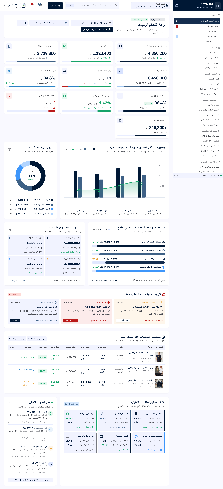
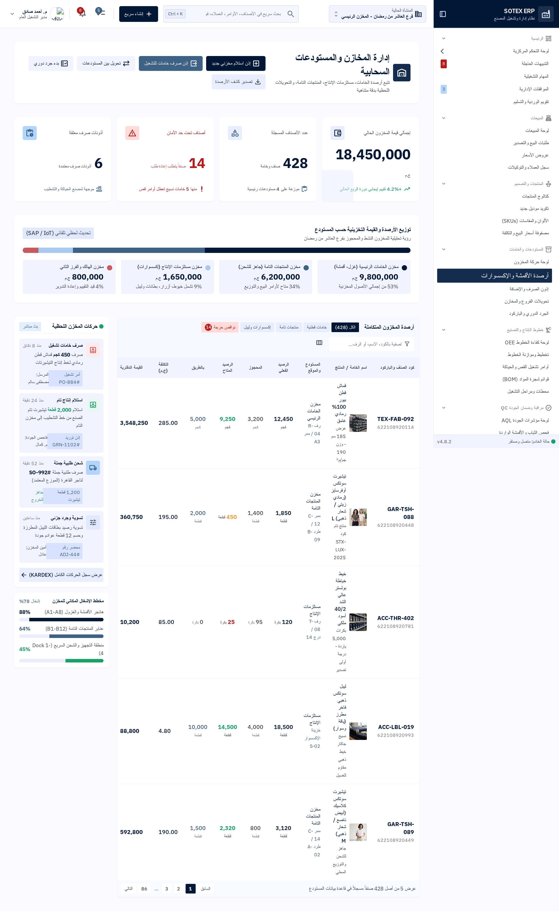
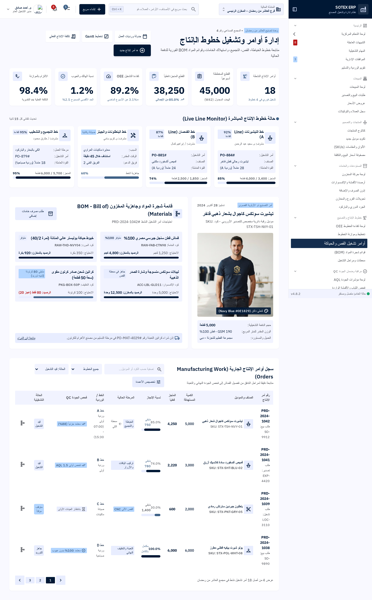
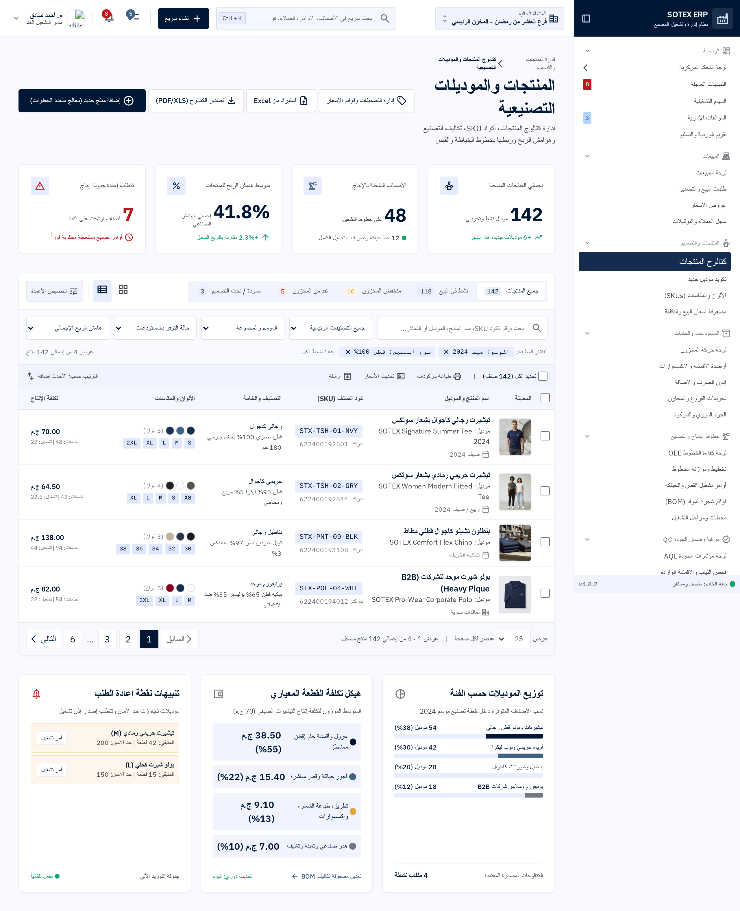
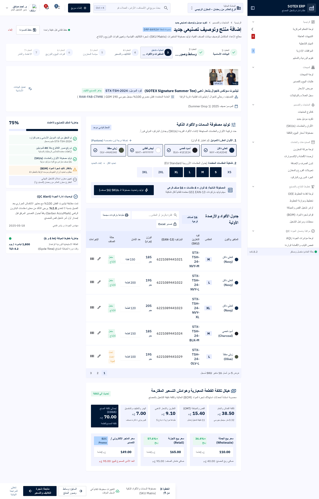
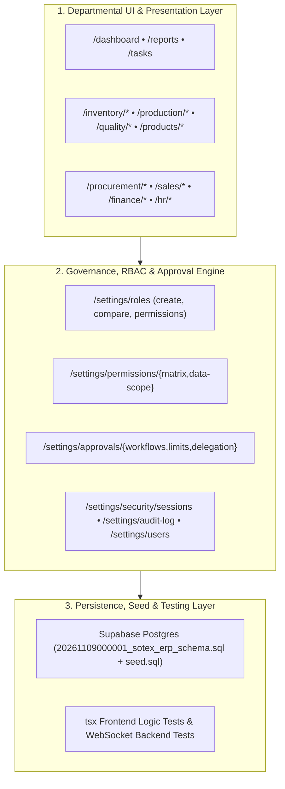
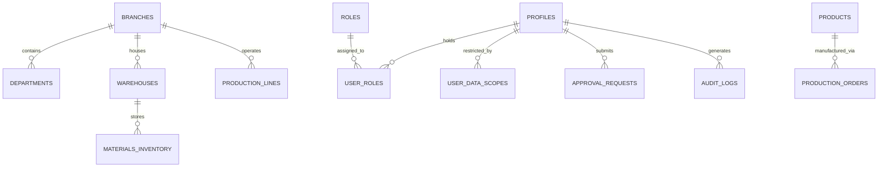

# Sotex ERP (`sotexerp`) — Enterprise Textile & Garment Manufacturing ERP

<p align="center">
  
</p>

## Table of Contents
- [Executive Summary & Business Utility](#executive-summary--business-utility)
- [Visual Showcase (UI & Dashboards)](#visual-showcase-ui--dashboards)
- [System Architecture & Layers](#system-architecture--layers)
- [Data Model & Analytics](#data-model--analytics)
- [Database Schema, Migrations & RLS](#database-schema-migrations--rls)
- [Application Modules & Workflows](#application-modules--workflows)
- [Getting Started & Scripts](#getting-started--scripts)
- [Business Value, ROI & Growth Opportunities](#business-value-roi--growth-opportunities)

---

## Executive Summary & Business Utility
`sotexerp` (`sotex-workspace` / `sotex/`) is an enterprise-grade, multi-branch **Textile & Garment Manufacturing ERP** built with Next.js, Radix UI, TypeScript, and Supabase. It unifies every core factory department—**Fabric & Material Inventory, Product SKUs, BOM & Multi-Stage Production (OEE), Inline Quality Inspections, Procurement, Sales, Double-Entry Finance, HR/Payroll, and Granular RBAC Approval Workflows**—into one auditable platform.

---

## Visual Showcase (UI & Dashboards)
Live UI screens located in `sotex/public/screens/`:

| Executive ERP Dashboard | Fabric & Materials Inventory | Production Orders |
| :---: | :---: | :---: |
|  |  |  |

| Products Management | New Product Wizard |
| :---: | :---: |
|  |  |

---

## System Architecture & Layers



| Layer | Responsibility | Key Modules |
| :--- | :--- | :--- |
| **Manufacturing & Quality Layer** | Fabric roll inventory, stock counts, transfers, BOM, production planning, OEE, and inline defect inspections | `sotex/app/{inventory,production,quality,products}/*` |
| **Commercial & Back-Office Layer** | Supplier quotations/invoices, customer sales, general ledgers, P&L, treasury, attendance, and payroll | `sotex/app/{procurement,sales,finance,hr}/*` |
| **RBAC & Approval Governance Layer** | Role comparison, data-scope isolation (branch/department/warehouse), monetary approval limits, delegation, and audit trails | `sotex/app/settings/{roles,permissions,approvals,security,users,audit-log}/*` |
| **Persistence & Verification Layer** | Supabase Postgres schema + seed data + dual `tsx` automated test suites | `sotex/supabase/migrations/20261109000001_sotex_erp_schema.sql`, `sotex/supabase/seed.sql`, `sotex/tests/*` |

---

## Data Model & Analytics


---

## Database Schema, Migrations & RLS
Defined in `sotex/supabase/migrations/20261109000001_sotex_erp_schema.sql` (plus `sotex/supabase/seed.sql`):

| Table | Purpose |
| :--- | :--- |
| `public.branches`, `public.departments`, `public.warehouses`, `public.production_lines` | Multi-branch organizational & plant topology |
| `public.roles`, `public.profiles`, `public.user_roles`, `public.user_data_scopes` | Fine-grained RBAC and row-level branch/warehouse data scoping |
| `public.products`, `public.production_orders`, `public.materials_inventory` | Core SKU catalog, factory work orders, and fabric/material stock |
| `public.approval_requests`, `public.audit_logs` | Multi-step approval workflow state and immutable compliance logs |

---

## Application Modules & Workflows

| Domain | Routes Implemented |
| :--- | :--- |
| **Executive** | `/dashboard`, `/reports`, `/tasks`, `/login` |
| **Inventory** | `/inventory`, `/inventory/fabrics`, `/inventory/fabrics/[id]`, `/inventory/stock-count`, `/inventory/transactions`, `/inventory/transfers` |
| **Production** | `/production`, `/production/[id]`, `/production/bom`, `/production/oee`, `/production/planning`, `/production/stages` |
| **Quality** | `/quality`, `/quality/defects`, `/quality/inline`, `/quality/inspections` |
| **Products** | `/products`, `/products/[id]`, `/products/new`, `/products/pricing`, `/products/skus` |
| **Procurement & Sales** | `/procurement/{suppliers,quotations,invoices}`, `/sales/{customers,quotations}` |
| **Finance & HR** | `/finance/{accounts,ledgers,pnl,treasury}`, `/hr/{employees,attendance,payroll}` |
| **Enterprise Settings** | `/settings/roles/{new,compare,[id]/permissions}`, `/settings/permissions/{matrix,data-scope}`, `/settings/approvals/{workflows,limits,delegation}`, `/settings/security/sessions`, `/settings/users/*`, `/settings/audit-log` |

---

## Getting Started & Scripts

```bash
git clone https://github.com/islamsamyy/sotexerp.git
cd sotexerp
npm --prefix sotex install
cp .env.example .env.local
```

| Script | Command | Description |
| :--- | :--- | :--- |
| Dev | `npm run dev` | Start Next.js dev server (`sotex/`) |
| Build | `npm run build` | Production build (`next build --webpack`) |
| Lint | `npm run lint` | Run ESLint |
| Backend Tests | `npm --prefix sotex run test:backend` | Run WebSocket backend integration tests |
| Frontend Tests | `npm --prefix sotex run test:frontend` | Run frontend logic unit tests |
| All Tests | `npm --prefix sotex test` | Run both frontend and backend test suites |

---

## Business Value, ROI & Growth Opportunities
- **Zero-Blindspot Factory Control**: Links fabric roll wastage and inline defect rates directly to production order margins and P&L statements.
- **Enterprise Governance Out-of-the-Box**: Multi-branch data scopes (`user_data_scopes`), approval monetary limits, and delegation rules make `sotexerp` ready for mid-to-large multi-plant textile groups.
- **Vertical SaaS Commercialization**: Generic ERPs struggle with textile BOMs and inline sewing/knitting quality checks—package `sotexerp` as a multi-tenant SaaS for apparel & textile manufacturers across Egypt, Turkey, and MENA.
- **Shop-Floor Barcode/RFID Add-On**: Connect handheld QR scanners directly to `/inventory/fabrics` and `/production/stages`.
