# البربوزال الهندسي والتجاري — منظومة SOTEX Garment ERP
# Engineering & Commercial Proposal — SOTEX Garment Manufacturing ERP

> **منظومة إدارة موارد مصانع الملابس الجاهزة والمنسوجات — الجيل الصناعي الذكي المدعوم بمحرك بحوث العمليات (OR) وحماية البيانات على مستوى قاعدة البيانات (PostgreSQL RLS).**

---

## 1. الملخص التنفيذي (Executive Summary)

تواجه مصانع الملابس الجاهزة والمنسوجات تحديات تشغيلية ومالية لا تستطيع أنظمة الـ ERP التقليدية (العامة) معالجتها بدقة، مثل: إدارة أرصدة الأقمشة بالـ Batch/Lot والوزن/المتر، مصفوفات الألوان والمقاسات (SKUs)، حساب كفاءة خطوط الإنتاج (OEE)، ضبط الجودة بنظام العينات القياسي (AQL)، احتساب الأجور بالقطعة (Piecework)، وحماية أسرار التكاليف وهوامش الربح من التسريب.

تقدم منظومة **SOTEX Garment ERP** حلاً متكاملاً ومصمماً خصيصاً لصناعة الملابس في مصر والشرق الأوسط، يربط **الإدارة التنفيذية، الإنتاج، المخازن، الجودة، المبيعات، المشتريات، المالية، والموارد البشرية** في منصة عربية (RTL-First) متصلة لحظياً بقاعدة بيانات **PostgreSQL (Supabase)** تضم **42 جدولاً علائقياً**، ومحمية بسياسات أمان **Row Level Security (RLS)** وسجل تدقيق غير قابل للتلاعب، بالإضافة إلى **محرك بحوث العمليات (Operations Research Engine)** لتعظيم الأرباح وتقليل الهالك.

---

## 2. الفوائد التجارية والعائد على الاستثمار (Business Benefits & ROI)

كيف يحقق النظام ربحاً مباشراً وملموساً للمصنع؟

| المحور | المشكلة التقليدية في المصانع | الحل في SOTEX ERP | الأثر المالي والتشغيلي (ROI) |
|---|---|---|---|
| **1. المزيج الإنتاجي (OR)** | تشغيل موديلات ذات هامش ربح أقل واستنزاف القماش والخطوط عليها | نموذج **Linear Programming** يحدد الكمية المثلى (`x*`) لكل موديل لتعظيم الربح تحت قيود القماش وساعات الخطوط | **تعظيم صافي الربح** من نفس الموارد المتاحة |
| **2. تقليل هالك القص والمخزون** | هالك مرتفع في فرشات القص وصرف خامات بدون ربط بأوامر التشغيل | ربط كل إذن صرف (`stock_movements`) بأمر تشغيل و`BOM` + حساب **EOQ** و**نقطة إعادة الطلب (ROP)** | **توفير 3%–5% من هالك الأقمشة** ومنع توقف الخطوط |
| **3. رفع كفاءة الخطوط (OEE)** | اكتشاف تأخر التسليم أو اختناق الخطوط بعد فوات الأوان | متابعة لحظية لـ `Availability × Performance × Quality` وترتيب الأوامر بـ **Critical Ratio (CR)** | **رفع الإنتاجية 10%–15%** بنفس التكاليف الثابتة |
| **4. حماية الهوامش والتكاليف** | اطلاع غير المصرح لهم على تكلفة القطعة أو منح خصومات عشوائية | عزل التكاليف عبر **PostgreSQL RLS** + سقوف خصومات واعتمادات مالية محددة لكل دور | **منع البيع بخسارة** وحماية أسرار التسعير |
| **5. تسريع السيولة النقدية** | تأخر تحصيل مديونيات العملاء أو غياب الرؤية اللحظية للأرباح | قائمة دخل لحظية (**P&L**) + متابعة الخزينة والبنوك والشيكات وأعمار الديون | **تسريع دورة التحصيل** وتقليل الديون المعدومة |
| **6. الحوكمة ومنع التلاعب** | تعديل أو حذف الفواتير والقيود في الأنظمة التقليدية | سجل تدقيق محصّن بـ **Database Trigger** يمنع أي `UPDATE` على `audit_logs` | **رقابة كاملة 100%** ومساءلة دقيقة |

---

## 3. البنية الهندسية والتقنية (Engineering Architecture)

### 3.1 المكدس التقني (Technology Stack)
- **الواجهة الأمامية (Frontend):** `Next.js 16.4.5` (App Router)، `React 19.3.0`، `TypeScript 5`، `Tailwind CSS 3.4` مع تصميم RTL-First ودعم الوضع الداكن والفاتح (SOTEX Charcoal `#202528` & Champagne Gold `#C8B276`).
- **قاعدة البيانات والباك إند (Backend & DB):** `Supabase (PostgreSQL)` عبر `@supabase/supabase-js` مع **42 جدولاً علائقياً** متصلة بالكامل.
- **الأمان وعزل الصلاحيات (RBAC + PostgreSQL RLS):**
  - حقن ترويسة الدور النشط (`x-sotex-role`) في كل استعلام مع تقييم سياسات RLS داخل PostgreSQL (`public.get_current_user_role()`).
  - حماية المسارات في الواجهة (`AppShell` + `canAccessRoute`) وإخفاء الوحدات غير المصرح بها تلقائياً في القائمة الجانبية (`Sidebar`).
  - منع تعديل سجل التدقيق عبر Trigger قاعدة بيانات (`trg_audit_logs_immutable`).
- **محرك بحوث العمليات ([`lib/or-engine.ts`](../sotex/lib/or-engine.ts)):**
  - `solveProductMixLP`: تعظيم الربح الخطي تحت قيود القماش وساعات التشغيل وسقف الطلب.
  - `prioritizeWorkOrdersOR`: جدولة أوامر التشغيل وفق النسبة الحرجة (`Critical Ratio`) وتواريخ الاستحقاق (`EDD`).
  - `calculateEOQAndROP`: حساب الكمية الاقتصادية للطلب (`EOQ`) ومخزون الأمان (`Safety Stock`) ونقطة إعادة الطلب (`ROP`).

### 3.2 مصفوفة الأدوار والصلاحيات (4-Tier RBAC Matrix)

| الدور الوظيفي | الكود البرمجي | الشاشة الافتراضية | رؤية التكاليف والربح | الاعتماد المالي | إدارة المستخدمين |
|---|---|---|---|---|---|
| **المدير التنفيذي / المالك** | `OWNER_ADMIN` | `/dashboard` | ✅ مسموح | ✅ غير محدود | ✅ مسموح |
| **المدير المالي والتجاري** | `FINANCE_SALES_MANAGER` | `/finance` | ✅ مسموح | ✅ حتى السقف المعتمد | ❌ محجوب |
| **مدير المصنع والإنتاج** | `PRODUCTION_MANAGER` | `/production` | ❌ محجوب (RLS) | ❌ محجوب (RLS) | ❌ محجوب |
| **الميرشندايز وسلاسل الإمداد** | `WAREHOUSE_MANAGER` | `/inventory` | ❌ محجوب (RLS) | ❌ محجوب (RLS) | ❌ محجوب |

---

## 4. استعراض وحدات النظام بالصور الحية (System Modules & Screenshots)

### 4.1 بوابة الدخول الموحدة (`/login`)
تتيح الدخول السريع أو بالبريد الإلكتروني وكلمة المرور مع توجيه تلقائي لكل دور وظيفي إلى لوحة القيادة الخاصة به.
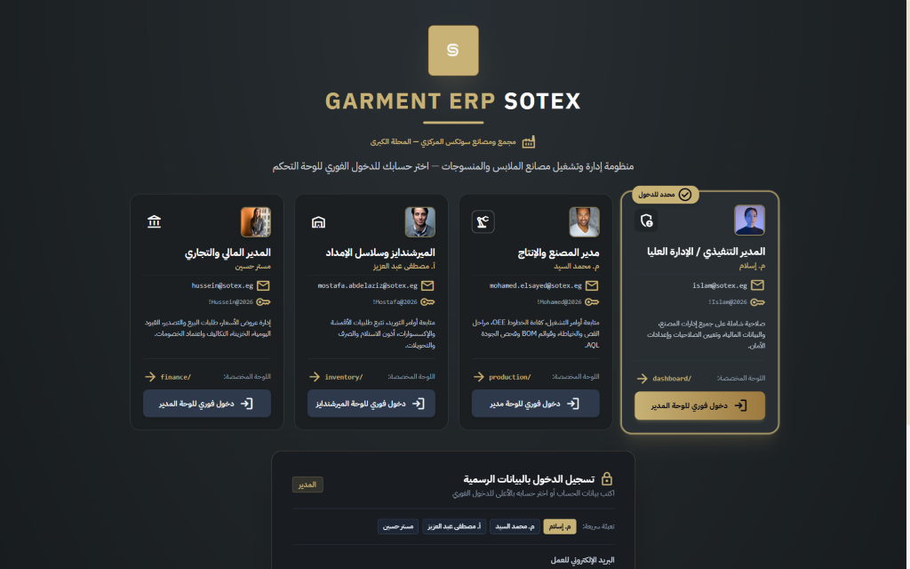

### 4.2 لوحة التحكم التنفيذية (`/dashboard`)
تعرض لحظياً إجمالي العقود، المصروفات التقديرية، صافي الربح، الإنتاج الشهري، متوسط الـ OEE، تقييم المخزون، نسبة قبول الجودة AQL، وأداء الخطوط.
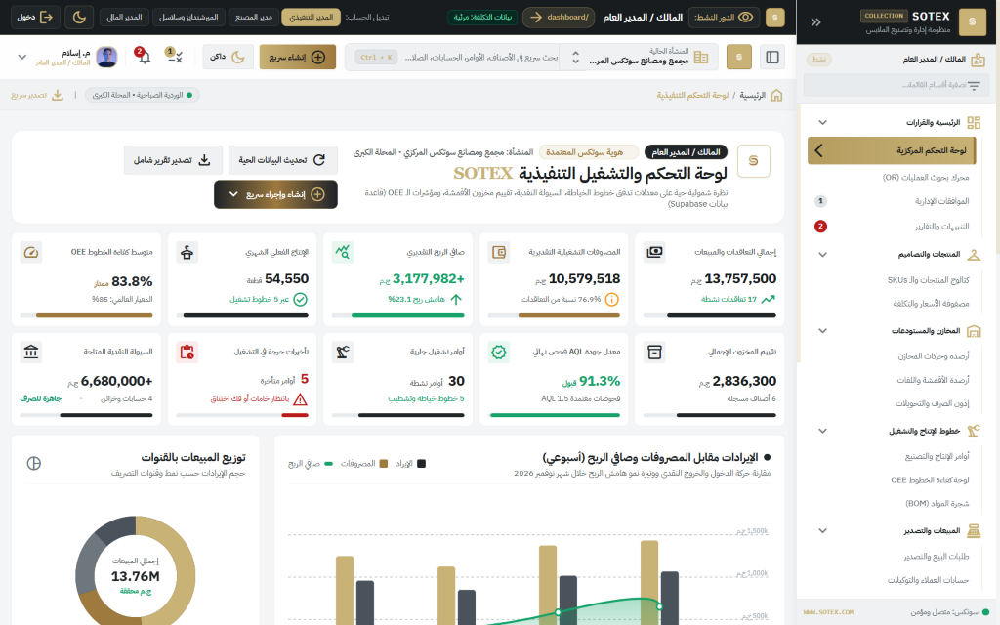

### 4.3 محرك بحوث العمليات وتعظيم الأرباح (`/optimization`)
يحوّل بيانات المصنع الحية إلى قرارات كمية لتعظيم الربح (Linear Programming)، جدولة الخطوط الحرجة (CR/EDD)، وتحسين المخزون (EOQ/ROP).
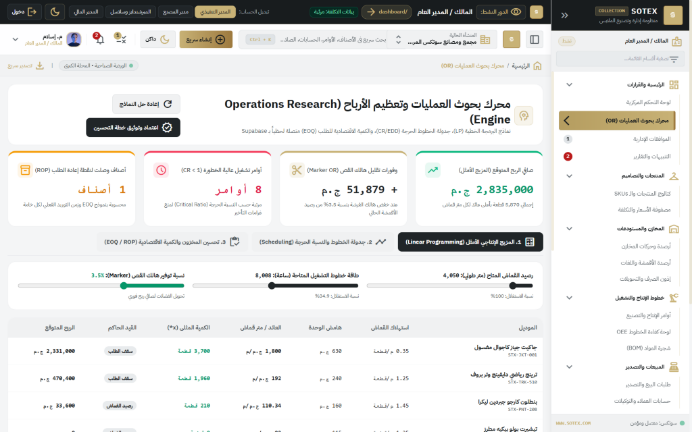

### 4.4 خطوط الإنتاج والتشغيل (`/production`)
متابعة أوامر التشغيل، نسب الإنجاز، الاختناقات، كفاءة المعدات OEE، وشجرة المواد (BOM).
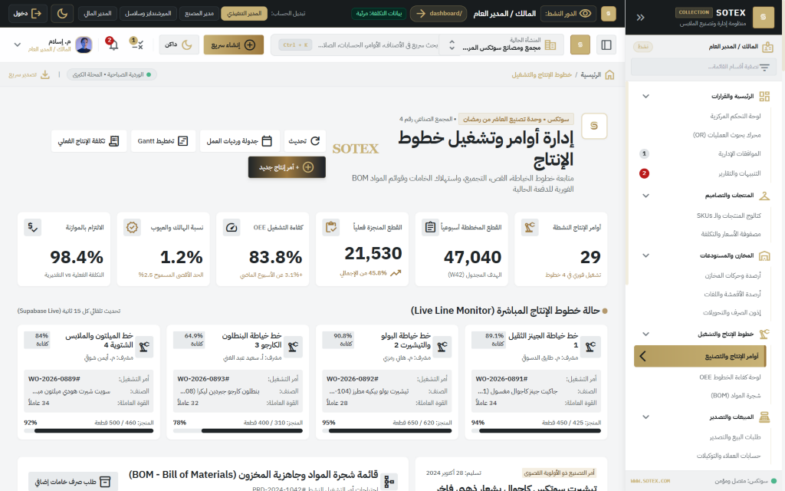

### 4.5 المخازن والأقمشة (`/inventory`)
إدارة الأرصدة، بالات الأقمشة بالـ Batch/Lot، أذون الصرف والاستلام، والتحويلات بين المخازن.
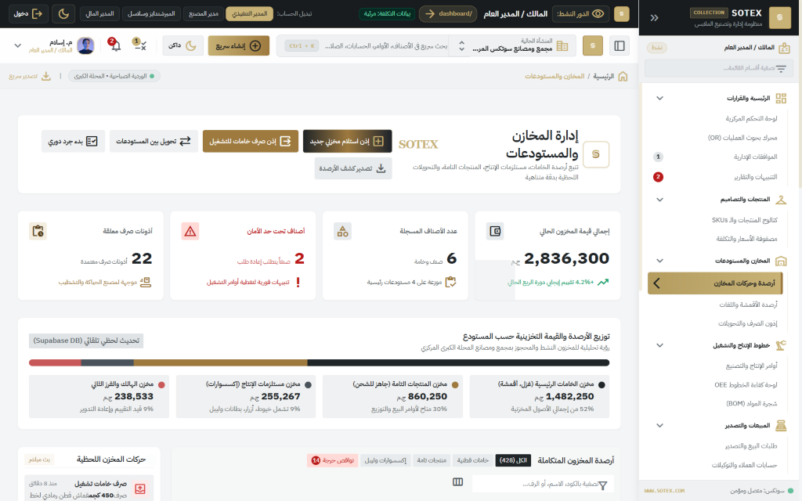

### 4.6 كتالوج المنتجات والألوان والمقاسات (`/products`)
إدارة الموديلات، مصفوفة الـ SKUs (لون × مقاس)، الباركود، والتكلفة وسعر الجملة والقطاعي.
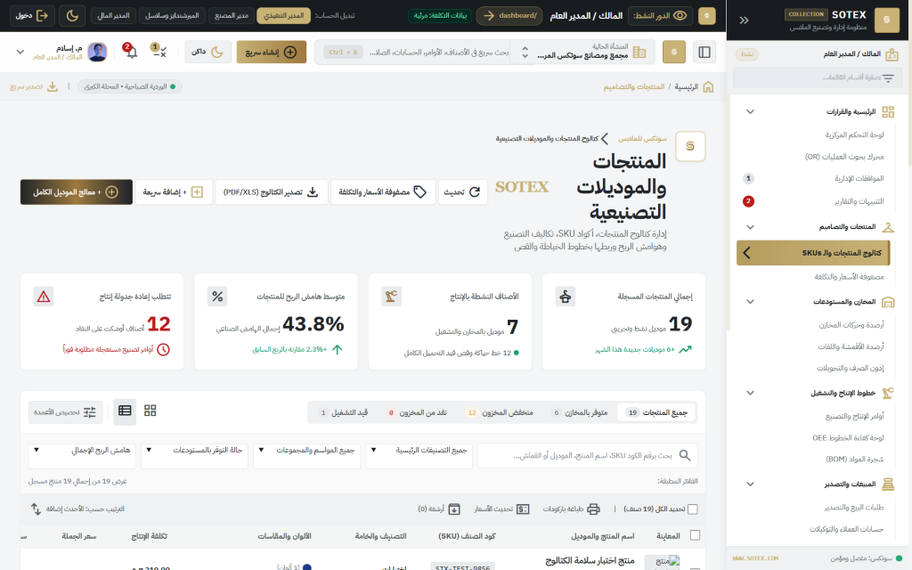

### 4.7 المبيعات والتصدير (`/sales`) والعملاء
متابعة عقود التوكيلات والتصدير، التحصيلات، والمديونيات المتبقية.
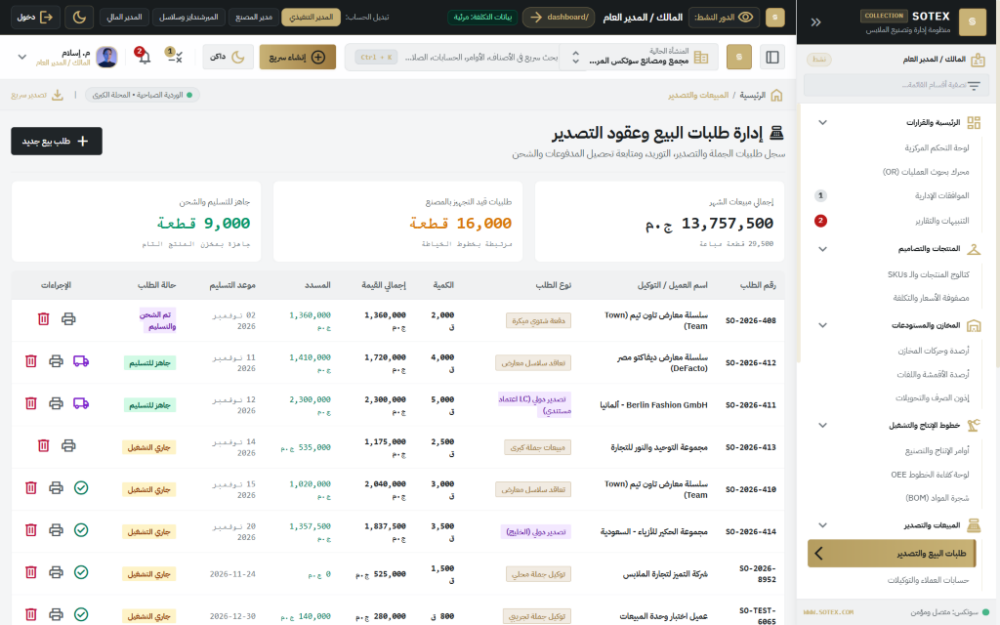

### 4.8 المشتريات والتوريد (`/procurement`)
إدارة أوامر الشراء، عروض الموردين (RFQs)، وفواتير الموردين.
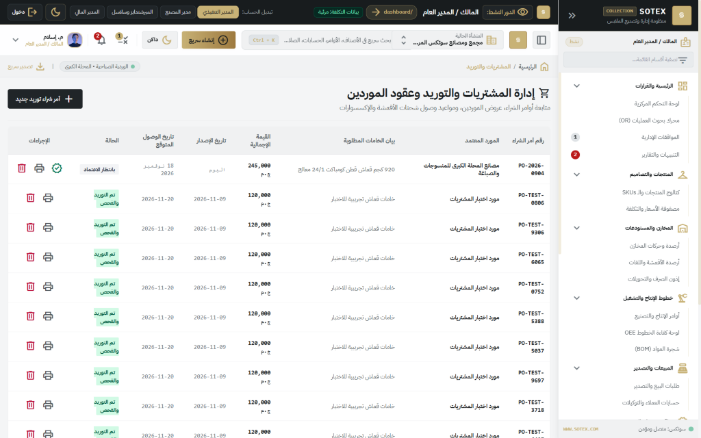

### 4.9 مراقبة وضمان الجودة (`/quality`)
فحوصات العينات القياسية AQL، فحص الخطوط المرحلي، وتتبع العيوب.
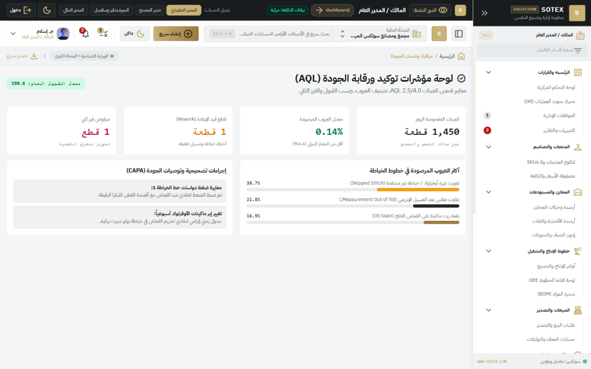

### 4.10 الإدارة المالية (`/finance`) وقائمة الدخل اللحظية (`/finance/pnl`)
متابعة السيولة النقدية، القيود اليومية، الشيكات، واحتساب قائمة الدخل (الإيرادات، COGS، OpEx، وصافي الربح EBIT) مباشرة من قاعدة البيانات.
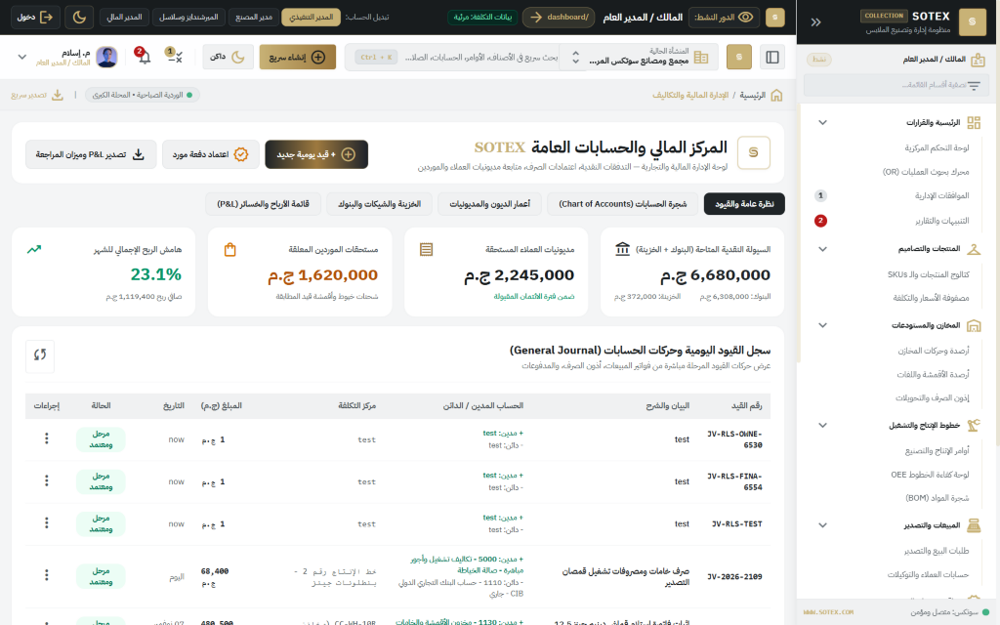
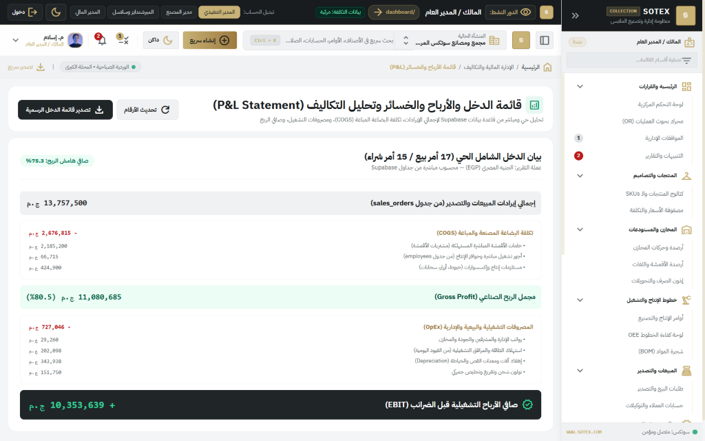

### 4.11 الموارد البشرية وأجور القطعة (`/hr/employees`)
سجل الفنيين والعمالة، الحضور والانصراف، واحتساب الرواتب وحوافز الإنتاج بالقطعة.
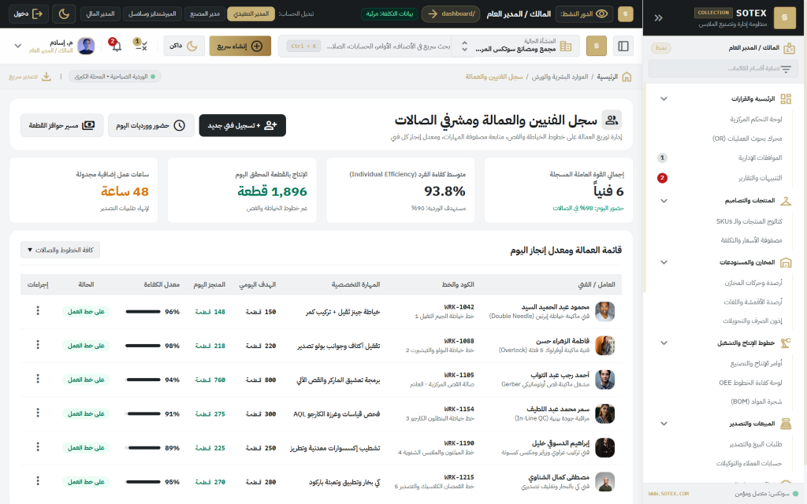

### 4.12 الحوكمة والأدوار وسجل التدقيق (`/settings/roles` & `/settings/audit-log`)
إدارة الأدوار الوظيفية، حدود الاعتماد المالي، وسجل التدقيق الرقابي غير القابل للتعديل.
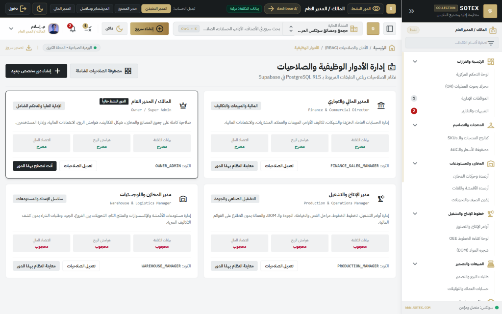
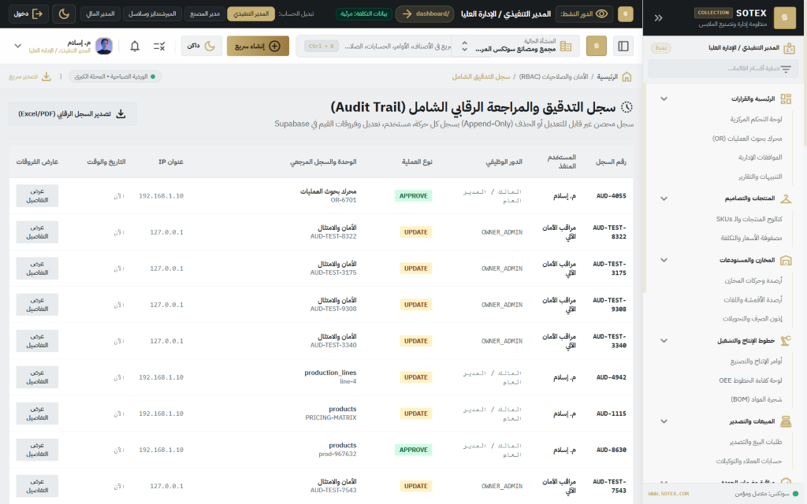

---

## 5. العرض التجاري وخطة التنفيذ (Commercial Proposal & Deployment Roadmap)

### 5.1 باقات التعاقد والتنفيذ المقترحة

| الباقة | النطاق المشمول | المدة التنفيذية | نموذج التشغيل |
|---|---|---|---|
| **باقة المصنع الأساسي (Core Factory)** | الإنتاج، المخازن والأقمشة، الجودة AQL، المنتجات، الموارد البشرية (أجر القطعة)، والـ RBAC | 2 – 3 أسابيع | استضافة سحابية مؤمنة (Cloud + Supabase RLS) |
| **باقة المؤسسة المتكاملة (Enterprise + Finance)** | جميع وحدات Core + المالية والقيود وقائمة الدخل P&L + المبيعات والمشتريات + سجل التدقيق | 3 – 4 أسابيع | استضافة سحابية مخصصة + نسخ احتياطي يومي |
| **باقة الذكاء التشغيلي (Enterprise + OR Engine)** | جميع وحدات Enterprise + **محرك بحوث العمليات (LP / EOQ / Scheduling)** + تدريب الإدارة | 4 – 6 أسابيع | تخصيص قيود المصنع ومعاملات الـ OR + دعم فني مباشر |

### 5.2 مراحل التسليم والتشغيل (Implementation Phases)
1. **الأسبوع 1 — التهيئة وترحيل البيانات (Setup & Data Migration):** إعداد شجرة الحسابات، تعريف الأدوار والمنشآت، واستيراد بيانات الموديلات والأقمشة والموردين والعمالة.
2. **الأسبوع 2 — التشغيل الموازي والتدريب (Parallel Run & Training):** تدريب فرق الإنتاج والمخازن والمالية والجودة على الدورات اليومية الفعلية.
3. **الأسبوع 3–4 — الإطلاق الكامل وضبط نماذج OR (Go-Live & Optimization):** تفعيل الإطلاق الكامل ومراجعة توصيات المزيج الإنتاجي ونقاط إعادة الطلب مع الإدارة التنفيذية.

---

## 6. التحقق والاختبارات الهندسية (Quality & Verification)
- **اختبارات منطق الواجهة ومحرك OR (`npm run test:frontend`):** 12/12 اختبار ناجح.
- **اختبارات الباك إند وقاعدة البيانات (`npm run test:backend`):** 14/14 اختبار ناجح (اتصال Supabase، تكامل 42 جدولاً، دورات CRUD كاملة، حقن RLS، ومناعة سجل التدقيق).
- **البناء الإنتاجي (`npm run build`):** 63/63 مسار مبني بنجاح بدون أخطاء TypeScript.
